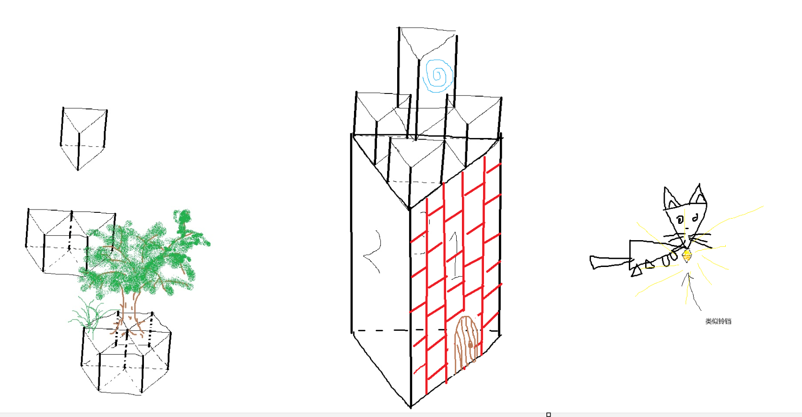
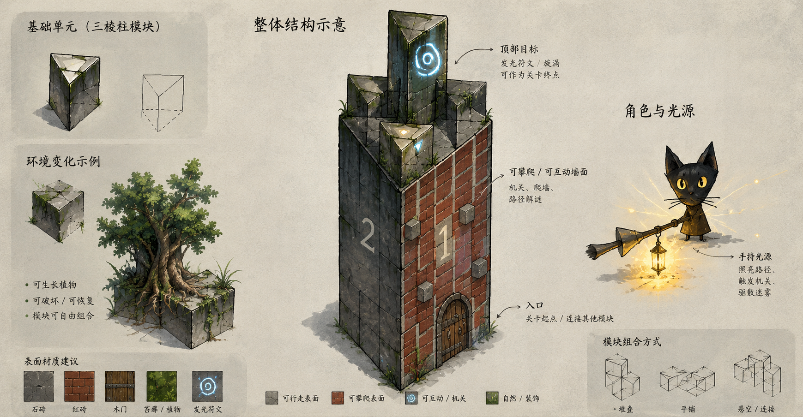

# 《失落国度》GameJam 游戏设计与开发总文档

> **文档性质：内部项目总文档 / GameJam Master Document**  
> **项目类型：空间迷宫 / 探索解谜 / 轻叙事**  
> **核心关键词：记忆、遗忘、空间建模、视角、迷雾、灯光、旧地图、内饰重建**  
> **目标时长：30–60 分钟**  
> **核心设计原则：少系统、强概念、低内容量、高体验密度**

---

# 1. 项目概述

## 1.1 一句话概念

玩家扮演一个存在于人脑内部的微小生命（猫），在一座已经破碎、逐渐消失的“失落国度”中探索。

玩家手里只有一张属于过去的旧地图。

眼前的城市却已经残破、模糊、充满迷雾。

玩家需要通过：

> **观察现实 → 对照旧地图 → 使用灯光寻找记忆 → 切换视角理解空间 → 解开迷宫**

直到最后才发现：

> 这不是一座真正的失落国度，而是一个老人正在逐渐失去的记忆世界。

玩家一路修复的，并不是城市。

而是一个人的人生。

---

# 2. 项目设计核心

## 2.1 游戏本质

本项目**本质上就是一个简单迷宫游戏**。

玩家的最终目标始终是：

> **从当前位置找到出口 / 下一处关键地点。**

通过改变：

> **玩家“能够理解这个迷宫的方式”**

制造复杂度。


## 2.2 核心体验循环

```text
观察环境 with 迷雾 和 围绕主角的灯光
   ↓
查看旧地图 (2.5D。也可以设计成找到NPC获取地图)
   ↓
形成对空间的猜测
   ↓
切换视角
   ↓
重新理解空间关系
   ↓
找到道路
   ↓
到达新的记忆区域
   ↓
空间被部分恢复
   ↓
获得新的信息
   ↓
继续探索
```

---

# 3. 世界观

## 3.1 表层世界观：失落国度

玩家最开始认为自己来到了一座已经毁灭的失落国度。

这里曾经繁华

但如今：建筑破碎、道路中断、空间错乱、大量区域被迷雾覆盖、某些房间只剩轮廓。

玩家得到一张旧地图。

地图记录的是：城市曾经完整时的样子。

## 3.2 深层世界观：大脑空间

失落国度实际上是老人的大脑空间，昔日的美好在岁月的侵蚀下逐渐遗忘因此才会变得破碎。

---

# 4. 主角

## 4.1 身份

猫


# 5. 城市与空间设计

## 5.1 空间原则

整个城市由三棱柱几何体构成，提供给玩家三个角度的视角，通过旋转视角来完成大部分的解密。

be like



GPT 生成版




# 6. 核心玩法系统


# 6.2 FEZ 式视角系统

本项目借鉴“多个视角观察同一个空间”的玩法语言，并增加视野迷雾：

> **旋转世界。**

关键点：

> **地图本身没有改变。**

改变的是：

> **玩家对地图的观察方式。**

---

## 6.3 视角的三层作用

### 第一层：发现道路

玩家原视角看不到道路。

切换视角后：

> 道路出现。

### 第二层：理解空间

玩家发现：

> 两个看起来相隔很远的位置，其实在另一个切面上相邻。

---

# 7. 迷雾系统

## 7.1 迷雾不是纯美术效果

迷雾是：

> **信息限制机制。**

玩家无法看到远处完整世界。

因此需要：

> 灯光 / 接近 / 观察

才能逐渐了解空间。

---

# 8. 灯光系统

## 8.1 灯光的核心作用

灯光不是普通手电筒。

它应该承担：

> **“唤醒记忆”的作用。**

与某物品交互后，回到过去，协助完成解密。

---

# 9. 旧地图系统

## 9.1 地图不是小地图

## 9.3 地图可以不完全正确

这是非常重要的叙事与玩法机制。

地图可能：

- 正确
- 过时
- 模糊
- 缺少细节

因此玩家不能无条件相信地图。

地图应该是证据，而不是答案。

---

# last 

> **玩家用一个非常简单的操作系统，逐渐构建出一个自己没有被直接告知的世界。**

这就是本项目“涌现”的核心。
